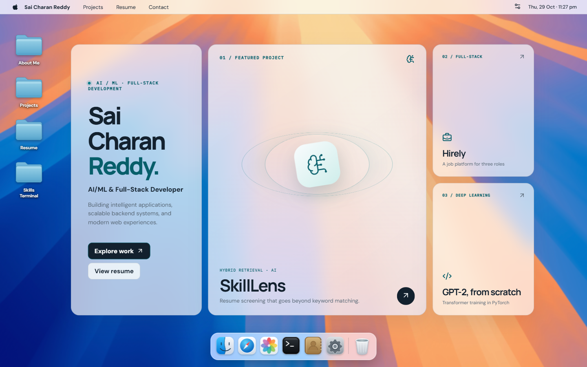
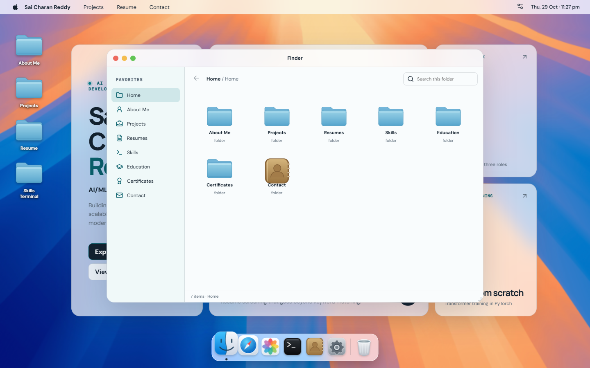
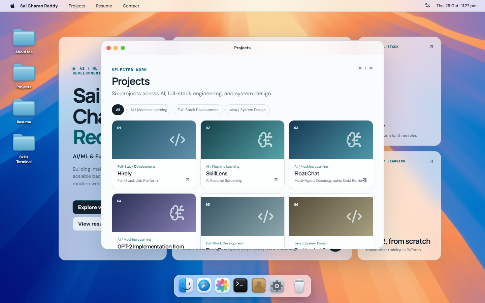
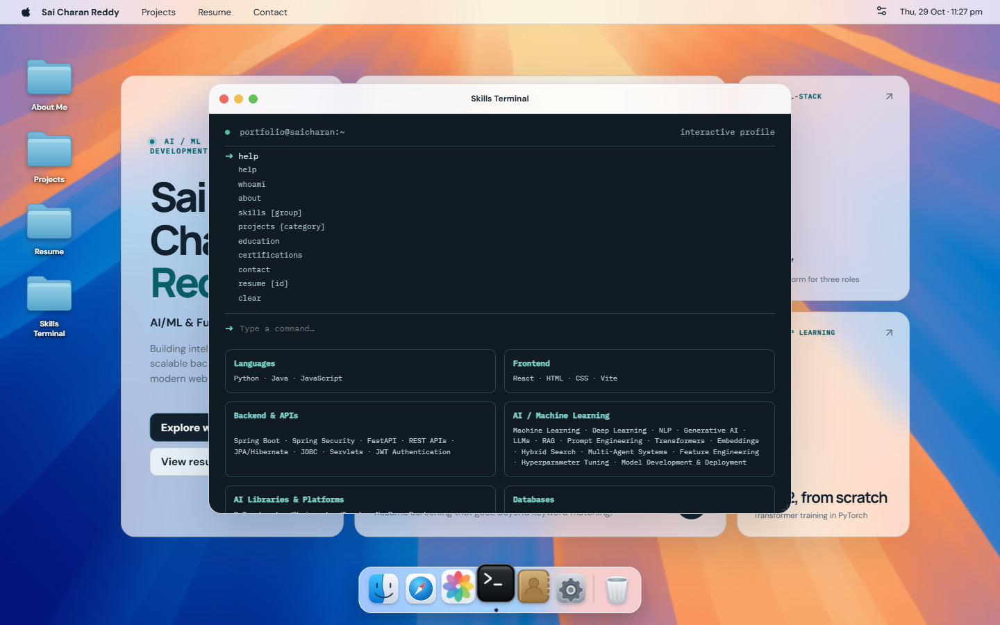
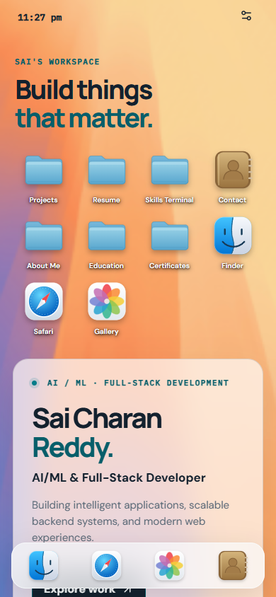

# Sai Charan Reddy's Interactive macOS Portfolio

An interactive portfolio for an AI/ML and full-stack developer. It presents projects, skills, education, credentials, and tailored resumes in a macOS-inspired desktop, with an iOS-inspired interface on mobile.

**Live demo:** [saicharan-portfolio-psi.vercel.app](https://saicharan-portfolio-psi.vercel.app/)



## Explore the interface

- **Desktop and dock:** Open portfolio apps from desktop shortcuts or the dock, with tooltips and active app indicators.
- **Windows:** Drag, resize, focus, minimize, maximize, restore, and close multiple app windows.
- **Finder:** Browse project categories and portfolio folders, search the current folder, and open project details.
- **Startup:** An initial HTML boot screen waits for the React app and selected wallpaper, then reveals the interface. A reload action is available if initialization fails.
- **Appearance:** Switch between light, dark, and system settings with matching wallpapers and a locally saved preference.
- **Projects and skills:** Explore six projects and use the simulated Skills Terminal to run commands such as `help`, `projects`, `skills`, and `education`.
- **Resumes:** Select, preview, open, and download three original PDF versions. The mobile preview includes zoom controls.
- **More apps:** Browse profile links in Safari, view the photo Gallery, explore education and certifications, open Contact, and inspect the simulated empty Trash.

<details>
<summary>More screenshots</summary>

**Finder**



**Projects**



**Skills Terminal**



**Mobile home**



</details>

## Tech stack

| Technology | Purpose |
| --- | --- |
| React and JavaScript | Application components and interactions |
| Vite | Development server and production build |
| Zustand | Window, theme, and resume state |
| GSAP and Draggable | Window motion and dragging |
| CSS and Lucide | Responsive styling and interface icons |
| PDF.js | Width-fitted mobile PDF previews |
| Playwright | Browser regression and startup checks |

## Project structure

```text
├── index.html                 # Early startup screen and entry point
├── public/
│   ├── icons/                 # Local desktop and app icons
│   ├── images/                # Portrait and campus photograph
│   ├── resumes/               # Three original PDF resumes
│   └── wallpapers/            # Light and dark desktop backgrounds
├── src/
│   ├── App.jsx                # Desktop, mobile shell, dock and window frames
│   ├── Content.jsx            # Finder and portfolio app content
│   ├── PersonalApps.jsx       # Safari profile cards and Gallery
│   ├── MobilePdfPreview.jsx   # Mobile PDF rendering
│   ├── store.js               # Zustand state and window operations
│   ├── appMeta.js             # App names, icons and categories
│   ├── data/portfolioData.json
│   └── *.css                  # Design, macOS and app styling
├── docs/screenshots/          # Captures from the running site
├── scripts/                   # Browser, startup and screenshot checks
└── vite.config.js
```

## Run locally

Requires Node.js `^20.19.0` or `>=22.12.0` and npm:

```sh
git clone https://github.com/saicharanreddyamedapu/macos-portfolio.git
cd macos-portfolio
npm ci
npm run dev
```

Open the local URL printed by Vite, normally `http://localhost:5173/`.

## Build and verify

```sh
npm run build
npm run preview
```

The build output is written to `dist/`. To run the browser checks, start the development server in one terminal and run the following in another:

```sh
npx playwright install chromium
npm run test:startup
npm run test:browser
```

Set `PORTFOLIO_TEST_URL` to test another deployment. An installed Edge or Chrome executable can be selected with `PLAYWRIGHT_BROWSER_PATH`.

## Deployment

The project is a static Vite application connected to Vercel through its GitHub repository. Vercel uses the Vite framework preset, `npm run build` as the build command, and `dist` as the output directory. The `main` branch is the production branch. The application does not require environment variables or a backend.

## Customize

1. Update `src/data/portfolioData.json` for biography, projects, skills, credentials, profile URLs, and resume labels.
2. Replace the portrait at `public/images/sai-charan-reddy.jpeg`, or update the data file's photo path. An initials fallback is available.
3. Replace the original PDFs in `public/resumes/` and update the corresponding paths and filenames in the data file.
4. Update icon mappings in `src/appMeta.js` and the SVG files in `public/icons/`.
5. Replace `public/wallpapers/light.webp` and `public/wallpapers/dark.png`; appearance rules live in `src/macos.css` and theme tokens in `src/styles.css`.

Below 768px, the app uses a touch-friendly home screen and full-screen app sheets. At larger widths it uses desktop windows and a dock. Reduced-motion preferences are respected.

## Asset attribution

The campus photograph is from [Bennett University's photo gallery](https://www.bennett.edu.in/bennett-life/gallery/); its reuse permission has not been verified. The wallpapers were supplied as references and their publication rights have not been established. Apple-related marks are used for visual inspiration and do not imply affiliation or endorsement.

## Author

**Sai Charan Reddy** · AI/ML & Full-Stack Developer

[GitHub](https://github.com/saicharanreddyamedapu) · [Email](mailto:saicharanreddyamedapu4@gmail.com)
